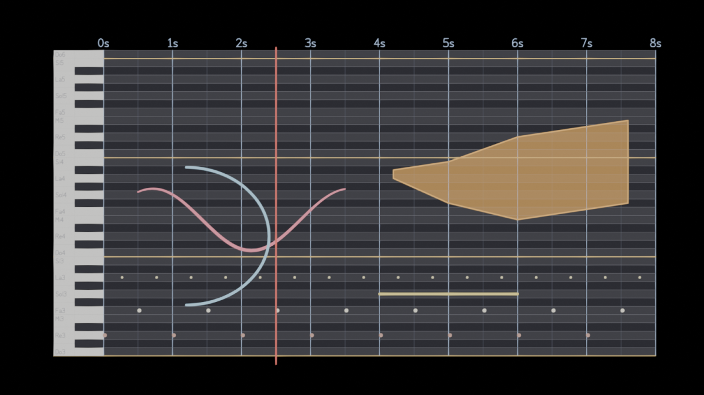

# Grease Pencil to Music

Add-on per **Blender 5.2** che trasforma i disegni Grease Pencil in musica.
Si ispira al *suono disegnato* di Norman McLaren e Daphne Oram (Oramics): si
disegna su una tavola, e la tavola suona.



- **X = tempo** (linee verticali = secondi, più tenui i battiti)
- **Z = altezza** (una riga per semitono, tastiera verticale a sinistra: tasti alti quanto le righe, neri verso la griglia)
- **Materiale = strumento**, con volume per strumento
- **Spessore, opacità, vertex color, morbidezza** modellano il suono (configurabile)
- **Forme piene = cluster** (note della scala coperte dalla forma, oppure banda di rumore)

> Stato: **0.0.x, prototipo**. Pacchetto solo per Windows x64 per ora.

## Installazione

1. Scarica `grease_pencil_to_music-<versione>-windows_x64.zip`.
2. In Blender: *Edit → Preferences → Get Extensions → ▾ (in alto a destra) → Install from Disk…*
3. Scegli lo zip. L'add-on si attiva da solo (un aggiornamento sostituisce la versione precedente).

## Uso

1. Nel viewport 3D: **Shift+A → Grease Pencil to Music → Composizione Musicale**.
   Viene creato **un unico oggetto** *Composizione Musicale 1*: la tavola (tastiera,
   griglia, etichette e testina) sta in gruppi di livelli bloccati dentro l'oggetto stesso.
   La composizione parte **vuota**: un livello con un solo strumento (Flauto). La vista
   passa a frontale, *Solid → Texture*; si resta in Object Mode (passa a **Draw Mode** per
   disegnare).
2. In *Proprietà → Dati oggetto → Livelli e strumenti*: **Nuovo livello** aggiunge un
   livello; dentro ogni livello ci sono i suoi strumenti e **+ Strumento** ne aggiunge
   altri (sintetizzati, percussioni, Campione, Libreria). Il pulsante accanto a uno
   strumento lo rende quello con cui disegni.
3. Disegna. Appena stacchi la penna il suono viene rigenerato.
4. Premi **Spazio**: la testina rossa scorre e senti il disegno, in loop.
   Nella **Timeline** vedi la forma d'onda e i blocchetti delle note (vedi sotto).
5. Modifica in **Edit Mode** o **Sculpt Mode**: il suono si aggiorna.
6. **Shift+D** duplica tutta la composizione: ogni copia è un nuovo "piano di lavoro"
   con le sue regole (strumenti, volumi, muti) e il suo suono.
7. **Ascolto** (pannello principale): *Tutte insieme*, *Solo l'attiva* oppure
   *Una dopo l'altra*.
8. In **Object Mode**, **S X** allunga o accorcia la composizione e **S Z** mostra più o
   meno ottave, senza deformare i tratti.

### Dove sono le impostazioni

| Dove | Cosa |
|---|---|
| Proprietà → **Dati oggetto** → Musica | stato, tavola e tempo, lettura, **livelli con i loro strumenti**, canone, canale del Sequencer |
| Proprietà → **Materiale** → Strumento musicale | tipo di strumento, volume, campione, effetti dello strumento |
| Proprietà → **Output** | export WAV / MP3 / MIDI, mix di tutta la scena |
| Proprietà → **Scena** | ascolto delle composizioni (canali, ordine, muto) |
| *File → Import / Export* | MIDI → Grease Pencil; composizione in WAV / MP3 / MIDI |
| Barra laterale **N → Musica** | versione compatta per quando disegni |
| Preferences dell'add-on | mappatura degli attributi (con preset), valori delle nuove composizioni, tastiera MIDI |

### Suonare con la tastiera

*Suona con la tastiera* (pannello N o Dati oggetto): **A W S E D F T G Y H U J K** sono le
note (come i tasti di un pianoforte), **Z / X** cambiano ottava, **R** registra (e fa partire
il play): ogni tasto tenuto diventa un tratto sul livello attivo. **Esc** esce.

Una **tastiera MIDI** collegata suona insieme alla tastiera del PC (velocity = volume, pedale
di sustain); la porta si sceglie nelle Preferences (vuoto = la prima trovata). Con le
sezioni da keyframe la nota registrata finisce nel disegno della sezione che sta suonando.

### Suono nella Timeline

Nell'header della Timeline / Dope Sheet, accanto agli Overlay, c'è il pulsante con la
**nota musicale**: lo accende e lo spegne, la freccia apre le opzioni.

| Opzione | Scelte |
|---|---|
| Sorgente | composizione attiva, tutte le composizioni, una composizione, mix del Sequencer, un canale del Sequencer, Speaker |
| Forma d'onda | picchi, piena, contorno, inviluppo RMS, nessuna |
| Mostra | note (MIDI), flusso ottico (curve dei tratti in lettura ottica) |
| Aspetto | altezza, opacità, colore |

Tutto si controlla dalla barra laterale **N → Musica**:

| Pannello | Cosa contiene |
|---|---|
| Grease Pencil to Music | stato, muto, avvisi, *Auto* (aggiornamento automatico), *Genera suono*, **Ascolto** (insieme / solo l'attiva / una dopo l'altra) |
| Tavola e tempo | BPM, durata del loop, nota più bassa, ottave, **etichette dei tasti** (solo Do, tasti bianchi, tutte, nessuna), griglia |
| Lettura | scala e tonica, quantizzazione ritmica, **swing**, nota minima, volume, **Usa modificatori** |
| Livelli e strumenti | **Nuovo livello**, ↑ / ↓; ogni livello è un riquadro con lettura, occhio (nascosto e muto), cestino e i suoi **strumenti** (colore, nome, **volume**, occhio); **+ Strumento**; volume, forme piene, canone ed effetti del livello |
| Esporta | **WAV**, **MP3**, **MIDI** |

### Come viene letto un tratto

- **Quantizzata**: il tratto cambia nota ogni volta che attraversa una riga.
  Le note vengono agganciate alla scala scelta e alla griglia ritmica (con swing).
- **Ottica (libera)**: alla McLaren, l'altezza segue la linea in modo continuo, con glissandi.
- **Legato (morphing)**: le note sono quelle della scala, ma il tratto è un'unica voce che
  scivola da una nota all'altra senza riattaccare (tempo di legato regolabile).
- **Gesto (tempo del disegno)**: il ritmo è quello della mano. Il tratto parte dove inizia
  e dura quanto hai impiegato a disegnarlo: una linea verticale tracciata in fretta è una
  scala rapida, una lenta è un arpeggio lento. I tratti senza tempo di disegno (import MIDI,
  registrati) vengono letti come *Quantizzata*.
- **Canone** (per livello): il livello si ripete in 2–4 voci che entrano dopo N battiti,
  ognuna trasposta di N semitoni rispetto alla precedente; in loop le voci rientrano
  dall'inizio, come in un canone a ruota.
- **Sezioni da keyframe** (*Tavola e tempo*): ogni keyframe Grease Pencil apre una sezione
  (strofa, ritornello…) che ripete il suo disegno fino al keyframe successivo; l'ultima
  suona un loop. La testina riparte a ogni sezione e la scena dura quanto il brano.
- **Forma piena** (tratto riempito): *Cluster tonale* suona tutte le note della scala che
  copre; *Banda di rumore* è rumore filtrato tra il bordo inferiore e superiore della forma
  (come il sintetizzatore ANS).
- Un punto (un tocco) è una nota breve; le percussioni suonano sempre un colpo solo.
- Un tratto che torna indietro nel tempo (semicerchio, cerchio, zig-zag) suona in ogni sua
  parte, come sotto un lettore ottico: un semicerchio sono due voci.

### Strumenti (sintetizzati)

Melodici: Flauto, Ocarina, 8-bit, Synth, Archi, Chitarra (Karplus-Strong), Campana (FM).
Percussioni: Percussioni (generiche, dipendono dalla riga), Cassa, Rullante, Charleston,
Piatto, Battimani, Tom (intonato sulla riga), Campanaccio.
**Campione**: qualsiasi suono di Blender (*Carica suono…* o un suono del Sequencer),
intonato sulla nota base. **Libreria**: un SoundFont (`.sf2`) o uno strumento SFZ (`.sfz`),
con scelta del preset; librerie libere: GeneralUser GS, FluidR3 (SF2), Versilian VCSL (SFZ,
CC0) — vedi [RESEARCH.md](RESEARCH.md). Ogni strumento ha anche i suoi effetti (scheda Materiale). Nel MIDI le percussioni usano
le note General MIDI della batteria.

### Preferences dell'add-on

| Voce | Opzioni (default in grassetto) |
|---|---|
| Nomi delle note | **C D E F G A B**, Do Re Mi Fa Sol La Si |
| Riprendi il play dopo Ctrl+Z | **sì** |
| Spessore | **Volume**, Volume + Vibrato, Vibrato, Brillantezza, Nessuno |
| Opacità | **Brillantezza**, Volume, Nessuno |
| Vertex color | **Nessuno**, Pan stereo (rosso = sinistra, blu = destra), Brillantezza |
| Morbidezza | **Attacco**, Nessuno |

**Preset**: *Classico* (quello sopra), *Espressivo* (jitter = vibrato, colore = pan),
*McLaren* (spessore e opacità = volume, colore chiaro = brillante), *Pulito* (ogni tratto
suona uguale).

*Volume + Vibrato* separa lo spessore in due: l'andamento lento è il volume,
l'irregolarità veloce (per esempio il jitter del pennello Ink) diventa vibrato.

## Web app per iPad (senza App Store)

La stessa idea gira anche nel browser, pensata per iPad e Apple Pencil: sezioni **Disegna**,
**Beat** (step sequencer), **MIDI** (piano roll, tastiera sul vetro, import .mid) ed
**Esporta** (WAV + MIDI in .zip, PNG, progetto .json).

Per installarla come app sulla schermata Home, che funziona anche offline:

1. Su GitHub: *Settings → Pages → Build and deployment → Deploy from a branch*, scegli il
   branch con questa cartella `docs/` (per esempio `main` dopo il merge) e la cartella
   **/docs**, poi *Save*.
2. Dopo un minuto apri in **Safari** sull'iPad
   `https://cre-pan.github.io/Grease-Pencil-to-Music/app/`.
3. *Condividi → Aggiungi alla schermata Home* (anche da Chrome per iPad: Condividi nella barra
   degli indirizzi → Aggiungi alla schermata Home). Si apre a tutto schermo e funziona anche
   senza connessione; i disegni restano salvati nell'app. Per esportare usa il foglio di
   condivisione → *Salva su File*.

Il sorgente è `web/app.html`; `python tools/build_web.py` rigenera `docs/app/` (pagina,
manifest, icone e service worker).

**Icona personalizzata**: `web/icon-template.png` (e `.svg`) è una griglia di costruzione a
sezione aurea, nello stile della griglia delle icone Apple, con in rosso la maschera
arrotondata che applica iPadOS. Disegna il logo su una tela quadrata 1024 o 2048 px con il
template come livello in alto, esporta un PNG quadrato senza angoli arrotondati come
`web/icon.png` e rilancia `tools/build_web.py`. I template ufficiali sono negli
[Apple Design Resources](https://developer.apple.com/design/resources/).

### Gesti della web app

| Gesto | Azione |
|---|---|
| Tocco con due / tre / quattro dita | annulla / ripeti / play-stop |
| Pinch, due dita che trascinano | ingrandisci, sposta la tavola |
| Tieni premuto su un tratto | contagocce: strumento e opacità |
| Tocco sui numeri di battuta | da dove parte il play |
| Livello: scorri a sinistra / a destra | elimina / seleziona più livelli |
| Livello: tieni premuto e trascina | cambia l'ordine |
| Occhio o altoparlante tenuti premuti | solo quel livello visibile / udibile |
| Nome di una traccia del beat tenuto premuto | volume e intonazione |

## Limiti noti (0.0.x)

- Senza *Sezioni da keyframe* viene letto solo il keyframe attivo all'inizio della scena.
- Le librerie SF2/SFZ usano un campione per tasto (niente strati di velocity né inviluppi
  del SoundFont).
- Con *Usa modificatori* vengono letti i tratti del frame corrente.
- Gli effetti visivi (shader effects) non cambiano il suono.
- La Chitarra non fa glissandi in modalità ottica.

## Sviluppo

I test usano Blender come modulo Python (`bpy` da PyPI):

```bash
python -m venv .venv
.venv/bin/pip install bpy==5.2.2 pytest
.venv/bin/python -m pytest
python tools/build_zip.py          # -> dist/grease_pencil_to_music-<versione>-windows_x64.zip
```

Vedi [DESIGN.md](DESIGN.md) per decisioni e roadmap, [RESEARCH.md](RESEARCH.md) per le fonti, [CHANGELOG.md](CHANGELOG.md) per le versioni.

## Licenza

GPL-3.0-or-later. La visualizzazione nella Timeline si ispira a
[Timeline Audio Visualizer](https://github.com/OwOpq/timeline-audio-visualizer) (GPL-3.0).
